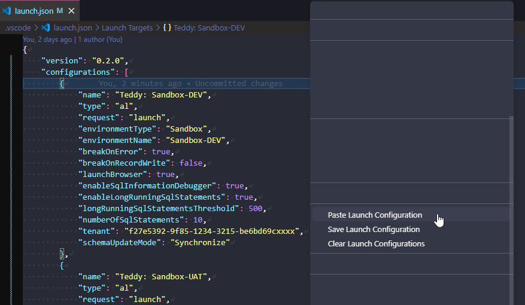

# Launch Config Manager



Save and reuse AL launch configurations across projects. Store configurations in your VS Code user settings and paste them into any project's `launch.json` with a single right-click.

## How to use

All commands are available from the **editor context menu** (right-click inside an open `launch.json` file → **AL Pocket Tools** submenu) and from the **Command Palette** (`Ctrl+Shift+P`).

### Paste a saved configuration

1. Open `.vscode/launch.json` in the editor.
2. Right-click → **AL Pocket Tools** → **Paste Launch Configuration**.
3. Pick a saved configuration from the Quick Pick list.
4. The configuration is appended to the `configurations` array.

If a configuration with the same `name` already exists in `launch.json`, you will be prompted to **Append Anyway**, **Replace**, or **Cancel**.

### Save a configuration to user settings

1. Open `.vscode/launch.json` in the editor.
2. Place your cursor inside the configuration object you want to save (optional — the list will highlight it automatically).
3. Right-click → **AL Pocket Tools** → **Save Launch Configuration**.
4. A Quick Pick lists all configurations in the file. The one your cursor is inside appears at the top with a `← cursor is here` marker.
5. Select the configuration to save. It is written to your VS Code user settings under `al-pocket-tools.launch.configurations`.

If a configuration with the same `name` already exists in your saved list, you will be prompted to **Replace** or **Cancel**.

## User settings format

Saved configurations are stored in your VS Code user `settings.json`:

```json
"al-pocket-tools.launch.configurations": [
    {
        "name": "bc28 (User)",
        "request": "launch",
        "type": "al",
        "environmentType": "OnPrem",
        "server": "http://bc28",
        "serverInstance": "BC",
        "authentication": "UserPassword",
        "startupObjectType": "Page",
        "breakOnError": true,
        "launchBrowser": true,
        "enableLongRunningSqlStatements": true,
        "enableSqlInformationDebugger": true,
        "tenant": "default",
        "schemaUpdateMode": "ForceSync"
    },
    {
        "name": "BC Sandbox-dev",
        "type": "al",
        "request": "launch",
        "environmentType": "Sandbox",
        "environmentName": "sandbox-dev",
        "breakOnError": "All",
        "launchBrowser": true,
        "tenant": "6af225e5-...",
        "schemaUpdateMode": "Synchronize"
    }
]
```

You can also edit this list directly in your user `settings.json` (`Ctrl+Shift+P` → **Preferences: Open User Settings (JSON)**).

### Clear all configurations

1. Open `.vscode/launch.json` in the editor.
2. Right-click → **AL Pocket Tools** → **Clear Launch Configurations**.
3. A confirmation prompt shows how many configurations will be removed. Click **Clear** to proceed or **Cancel** to abort.
4. The `configurations` array is set to `[]`.

If the array is already empty, an info message is shown and no changes are made.

### Clear and paste a configuration

1. Open `.vscode/launch.json` in the editor.
2. Right-click → **AL Pocket Tools** → **Clear and Paste Launch Configuration**.
3. Pick a saved configuration from the Quick Pick list.
4. A confirmation prompt shows how many existing configurations will be removed. Click **Clear and Paste** to proceed.
5. All existing configurations are removed and the selected configuration is inserted in their place, adopting the file's indentation style.

If the `configurations` array is empty, the configuration is simply inserted. If the file has no `configurations` key at all, it is created automatically.

### Clear all configurations in the entire workspace

1. Run **AL Pocket Tools: Clear All Launch Configurations in Workspace** from the Command Palette (also available in the right-click menu when a `launch.json` is open).
2. The command scans every workspace folder (multi-root aware) for a `.vscode/launch.json` and counts the configurations in each.
3. A confirmation prompt shows the total number of configurations and lists the affected files. Click **Clear All** to proceed.
4. Each file's `configurations` array is emptied and the files are saved automatically.

Files with no `configurations`, an already-empty array, or JSON syntax errors are skipped — if any file failed to parse, the result message tells you.

## Commands

| Command | Palette title | What it does |
|---|---|---|
| `al-pocket-tools.pasteLaunchConfig` | AL Pocket Tools: Paste Launch Configuration | Pick from saved configs and append (or replace) in the open `launch.json` |
| `al-pocket-tools.saveLaunchConfig` | AL Pocket Tools: Save Launch Configuration | Pick from configs in the open `launch.json` and save to user settings |
| `al-pocket-tools.clearLaunchConfigs` | AL Pocket Tools: Clear Launch Configurations | Clear the `configurations` array in the open `launch.json` (with confirmation) |
| `al-pocket-tools.clearAndPasteLaunchConfig` | AL Pocket Tools: Clear and Paste Launch Configuration | Remove all configurations in the open `launch.json` and insert a saved configuration in one step (with confirmation) |
| `al-pocket-tools.clearAllLaunchConfigsInWorkspace` | AL Pocket Tools: Clear All Launch Configurations in Workspace | Clear the `configurations` array in every `.vscode/launch.json` across all workspace folders (with confirmation) |

## Edge cases

- **No saved configurations** — Paste will show an info message directing you to use Save first.
- **Empty `configurations` array** — Paste correctly inserts the first entry.
- **Missing `configurations` key** — If `launch.json` has no `configurations` key at all, Paste creates the array and inserts the config automatically.
- **JSONC (comments in launch.json)** — Line comments (`//`) and block comments (`/* */`) are stripped before parsing. Comments are preserved in the file for all other content since only targeted insertions or replacements are made.
- **Indentation** — The pasted configuration adopts the indentation style already present in the file (tabs or spaces, detected automatically). If the file is empty or has no existing entries, 4-space indentation is used as a default.
